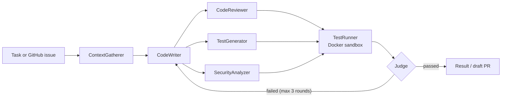

# AgentCollab

A multi-agent coding assistant. Four AI agents work together on a coding task: one writes the
change, three others review it, write tests for it and check it for security problems in
parallel. The tests run in an isolated sandbox, and any failure goes back to the writer as
feedback until the change passes or the run hits its round or budget limit.

Orchestrated with **LangGraph**, served by **FastAPI**, with a live **React** view of the agents
at work. It runs on OpenAI, Anthropic Claude or any OpenAI-compatible API.

## How a run works



1. **ContextGatherer** sends small repos whole. For large ones it picks the files the task
   names, what they import, their tests and project docs, up to a size limit.
2. **CodeWriter** proposes a change as complete new file contents. A diff is computed from them.
3. **CodeReviewer**, **TestGenerator** and **SecurityAnalyzer** inspect the change at the same
   time. They return structured output: review comments with severities, pytest files, and
   findings with CWE ids.
4. **TestRunner** runs the repo's tests plus the generated ones in a throwaway container.
5. **Judge** passes the round when tests pass with no blocking review or security issues.
   Otherwise it sends the test output and blocking issues back to CodeWriter.

TestRunner and Judge are plain code, not AI. Pass or fail comes from actually running tests.

## Features

- **Parallel agents with shared state**: a LangGraph `StateGraph` fans out to three agents
  and joins before testing, with reducers merging their results.
- **Failure handling**:
  - retries with backoff on rate limits and server errors
  - each malformed reply gets one repair attempt
  - a failing agent doesn't stop the round; the judge works with what arrived
  - a per-run budget stops spending
  - crashed runs resume from their last finished step (LangGraph checkpoints in SQLite or Postgres)
- **Sandboxed execution**: generated code only runs in a container with:
  - no network
  - capped CPU, memory and processes
  - a non-root user and read-only root filesystem
  - all capabilities dropped
  - no secrets
- **Cost tracking**: every model call is logged with tokens (including prompt-cache reads and
  writes) and cost, priced against the model that actually served it.
- **Cost optimizations**, each switchable so it can be measured against a baseline (see below).
- **Live UI and replays**: a WebSocket streams every step and model call to a React Flow graph,
  timeline, diff viewer and cost meter. Finished runs replay at 1×, 4× or 16×.
- **GitHub App**: label an issue `agentcollab` and a passing change is opened as a draft PR
  that links back to the run ([setup](docs/github-app.md)).
- **Benchmark**: 20 tasks (features, bug fixes, security fixes) graded by hidden tests the
  agents never see.

## Quick start

Requirements: Python 3.12, Node 22, Docker.

```bash
git clone https://github.com/altesse-imena/AgentCollab && cd AgentCollab

# Sandbox image the tests run in
docker build -t agentcollab-sandbox:latest backend/sandbox-image

# Backend
cd backend
python3.12 -m venv .venv && .venv/bin/pip install -e ".[dev]"
cp .env.example .env              # pick a provider and add its API key
.venv/bin/uvicorn agentcollab.main:create_app --factory --reload

# Frontend (second terminal), then open http://localhost:5173
cd frontend && npm install && npm run dev
```

From the command line:

```bash
.venv/bin/agentcollab run "Add a function that reverses a string" --repo ../path/to/repo
.venv/bin/agentcollab run "..." --repo ../path/to/repo --apply   # write the result to disk
.venv/bin/agentcollab runs                                       # recent runs
.venv/bin/agentcollab resume <run-id>                            # continue a crashed run
```

## Switching model providers

Set `AGENTCOLLAB_PROVIDER` in `backend/.env`. No code changes are needed.

| Provider | Setting | Key | Default model |
|---|---|---|---|
| OpenAI | `openai` | `OPENAI_API_KEY` | `gpt-4.1` |
| Anthropic Claude | `anthropic` | `ANTHROPIC_API_KEY` | `claude-opus-5-5` |
| Any OpenAI-compatible API (OpenRouter, Groq, Together, Ollama...) | `openai_compatible` + `AGENTCOLLAB_BASE_URL` | `AGENTCOLLAB_API_KEY` | set `AGENTCOLLAB_MODEL` |

Each agent can use its own model (`AGENTCOLLAB_MODEL_WRITER`, `_REVIEWER`, `_TESTER`,
`_SECURITY`). Every model call goes through one client
([`llm/client.py`](backend/agentcollab/llm/client.py)), and each provider is one small adapter
in [`llm/providers/`](backend/agentcollab/llm/providers). To add a provider, write an adapter and
add its prices to [`llm/pricing.py`](backend/agentcollab/llm/pricing.py).

## Benchmark and cost measurement

```bash
.venv/bin/agentcollab eval --check                 # validate the tasks (no model calls)
.venv/bin/agentcollab eval --label my-run          # run all 20 tasks
.venv/bin/agentcollab eval-compare baseline my-run # compare saved results
../scripts/measure-costs.sh                        # baseline vs optimizations, end to end
```

Each task in [`evals/tasks/`](evals/tasks) has:
- the starting repo the agents see
- hidden tests used only for grading
- a reference solution

`--check` confirms every task's hidden tests fail on the starting code and pass with the
solution.

**Cost optimizations.** Each is off by default so it can be compared with a baseline:

| Optimization | Setting | What it does |
|---|---|---|
| Cheaper models for some roles | `AGENTCOLLAB_LIGHT_ROLES=reviewer,security` | runs those agents on `gpt-4.1-mini` / `claude-sonnet-5-5` |
| Response cache | `AGENTCOLLAB_RESPONSE_CACHE=true` | identical requests (reruns, resumed runs) are answered from the database |
| Context limit | `AGENTCOLLAB_CONTEXT_LIMIT_CHARS` | large repos send only the most relevant files |
| Prompt ordering | always on | stable content comes first so provider prompt caches reuse it across rounds |

**Results:** _not measured yet._ Run `scripts/measure-costs.sh` and paste its table here.

## Deployment

The [`Dockerfile`](Dockerfile) builds one image that serves the API and the UI. By default it
runs **replay-only** and imports real recorded runs from [`demo/runs.json`](demo), so a public
demo makes no model calls ([how to record them](demo/README.md)). [`railway.json`](railway.json)
deploys it to Railway with a health check.

Live runs need a Docker daemon for the sandbox, so run them on a machine with Docker. For a
public server that allows live runs, cap spending with:

- `AGENTCOLLAB_RUNS_PER_IP_PER_DAY`: runs per visitor per day (visitors are tracked by a salted
  hash, not their IP)
- `AGENTCOLLAB_DAILY_BUDGET_USD`: total daily spend; unfinished runs count at their full budget

## Security model

- Generated code runs only in the locked-down sandbox described above.
- Model-supplied file paths are rejected if they are absolute, contain `..`, touch `.git` or
  resolve outside the repo.
- Task and issue text is treated as data; every prompt tells agents to ignore instructions
  inside it.
- GitHub webhooks need a valid HMAC signature. Installation tokens reach git through environment
  config, never in arguments or remotes. PRs are always drafts.
- The API only runs on local repo paths when `AGENTCOLLAB_ALLOW_LOCAL_REPOS=true`.

## Project layout

| Path | Purpose |
|---|---|
| `backend/agentcollab/graph/` | LangGraph workflow, state and judge logic |
| `backend/agentcollab/agents/` | the four agents and their prompts |
| `backend/agentcollab/llm/` | model client: retries, validation, budgets, cache, cost logging |
| `backend/agentcollab/sandbox/` | Docker test runner |
| `backend/agentcollab/github/` | GitHub App client and issue handler |
| `backend/agentcollab/main.py` | HTTP + WebSocket API |
| `frontend/src/` | React UI; `lib/runState.ts` turns events into what's shown |
| `evals/tasks/` | benchmark tasks |

## Development

```bash
cd backend && .venv/bin/pytest -q && .venv/bin/ruff check . && .venv/bin/ruff format --check .
cd frontend && npm test && npm run lint && npm run format:check && npm run build
```

The backend tests use fake models, so they're free. They cover:
- the workflow, failure handling, checkpoints, the API, limits and the GitHub flow
- both provider SDKs against mocked HTTP
- the real Docker sandbox, when available

CI runs everything on each push.

## Limitations

- The sandbox image has Python and pytest only, so target repos are Python projects whose tests
  need no extra packages. Bake dependencies into `backend/sandbox-image/Dockerfile` to widen this.
- CodeWriter returns whole files, which suits small and medium files. Very large files would be
  better served by edit-based output.
